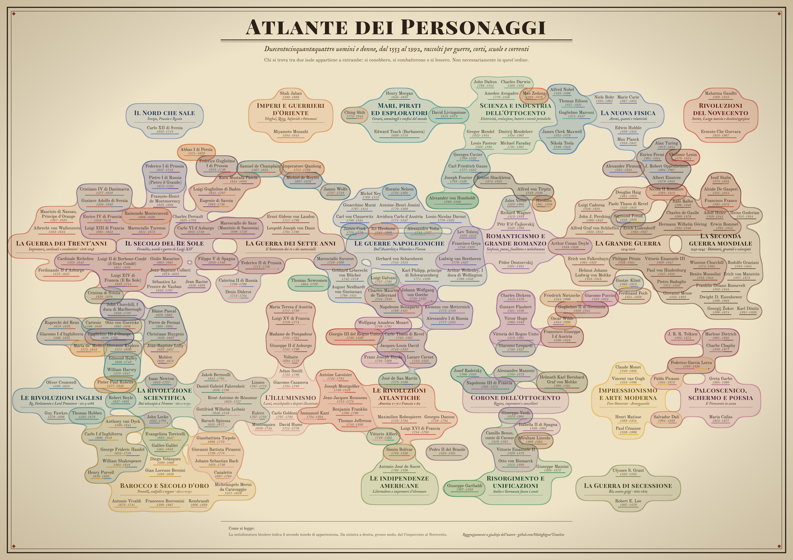

# Timeline dei personaggi storici

**Interactive history timeline & infographic poster** · 256 historical figures, 1553–1992 · kings, generals, scientists and artists: who lived at the same time as whom.

*🗺️ Il poster dei 254 nomi generato con Claude: l'obiettivo è generarlo ancora più bello.*

👉 **[Prova la timeline online](https://maloghigno.github.io/Timeline/)**

---

## 📜 Cos'è

Una **linea del tempo interattiva** con **256 personaggi storici** vissuti tra il 1553 e il 1992: da **Galileo** a **Churchill**, da **Napoleone** a **Picasso**, attraverso l'**Illuminismo**, il **Risorgimento**, le **Guerre mondiali**.

Risponde alla domanda che i libri di storia non hanno mai sopportato: *chi era vivo nello stesso momento di chi?* Spoiler: molti più di quanti pensi, e parecchi si conoscevano pure. Il che spiega diverse guerre.

Passa il mouse su un personaggio e compare la **schedina**: foto da Wikipedia, nome, date e una frase scritta a mano, cattiva il giusto.

> *Arciduca Carlo d'Austria (05/09/1771 – 30/04/1847): l'avversario di Napoleone che teorizzava la guerra mentre Clausewitz la rimuginava.*

## 🎲 Piccole coincidenze

- **Charlie Chaplin** (16/04/1889) e **Adolf Hitler** (20/04/1889) nascono a quattro giorni di distanza. Uno ha fatto ridere il mondo, l'altro no.
- **Charles Darwin** e **Abraham Lincoln** nascono lo stesso giorno, il 12/02/1809. Uno ha riscritto l'origine dell'uomo, l'altro i suoi diritti.
- **Mozart** e **Robespierre** sono quasi coetanei (1756 e 1758) e muoiono a tre anni di distanza: il primo a 35 anni, di malattia; il secondo a 36, di ghigliottina.

## 👥 Chi sono i 256 (per ora)

| Categoria | Chi | n |
|---|---|---|
| 👑 Main | re, regine, politici, dittatori | 67 |
| ⚔️ Military | generali, ammiragli, un paio di pirati | 67 |
| 🔭 Scientist | scienziati, filosofi, esploratori | 62 |
| 🎨 Artist | pittori, musicisti, scrittori, attori | 60 |

## 🚀 Come si usa

**Online:** [maloghigno.github.io/Timeline](https://maloghigno.github.io/Timeline/).

**In locale:** niente build, niente `npm install`, niente drammi. Scarica il repo e apri `index.html` nel browser. Serve la connessione, perché il grafico usa Google Charts e le foto arrivano da Wikipedia.

## 🛠️ Come è fatto

HTML e JavaScript puri, senza framework.

- **`index.html`**: il codice e l'elenco dei personaggi (`users.insert(...)`), con [LokiJS](https://github.com/techfort/LokiJS) come mini-database e [Google Charts Timeline](https://developers.google.com/chart/interactive/docs/gallery/timeline) per il disegno.
- **`src/descrizioni.js`**: le frasi delle schedine, una per personaggio.
- **`asset/`**: il poster.

## ➕ Aggiungere un personaggio

1. Una riga `users.insert({...})` in `index.html`. ⚠️ **In JavaScript i mesi partono da 0**: gennaio è `0`, dicembre è `11`. È già successo, non succederà più (forse).
2. Se la data esatta non si conosce, `birth_year_only: true` e/o `death_year_only: true`.
3. Una frase in `src/descrizioni.js`, con lo stesso identico nome.

Se una foto non compare, di solito il titolo della voce Wikipedia non coincide con il nome: basta aggiungerlo a `WIKI_TITOLI` in `index.html`. Altrimenti restano le iniziali, che fanno comunque la loro figura.

## 💬 Contribuire

Manca il tuo personaggio preferito? Hai trovato una data sbagliata? Hai un'idea per rendere tutto più bello o interattivo? **[Apri una issue](https://github.com/Maloghigno/Timeline/issues)**.

Le **frasi sono opinioni**, non fonti. Le date sono state controllate dove c'era un dubbio, ma qualche errore può sempre sfuggire: è storia, non teologia.

## 🙏 Crediti

- Foto dei personaggi: [Wikipedia](https://it.wikipedia.org), caricate dal browser al momento.
- Grafico: [Google Charts](https://developers.google.com/chart). Mini-database: [LokiJS](https://github.com/techfort/LokiJS).
- Frasi, raggruppamenti del poster e scelta dei personaggi: opinioni dell'autore, da prendere come tali.

## 📄 Licenza

[MIT](LICENSE) © 2026 Federico ([Maloghigno](https://github.com/Maloghigno)). Puoi riusare, modificare e ridistribuire liberamente, a patto di conservare la nota di copyright con l'attribuzione all'autore.

---

🔎 *Parole chiave: storia, linea del tempo, timeline storica, infografica, personaggi storici, storia moderna, storia contemporanea, Barocco, Illuminismo, Rivoluzione francese, Napoleone, Risorgimento, Prima guerra mondiale, Seconda guerra mondiale, storia della scienza, storia dell'arte · history timeline, historical figures, infographic, data visualization, world history.*
