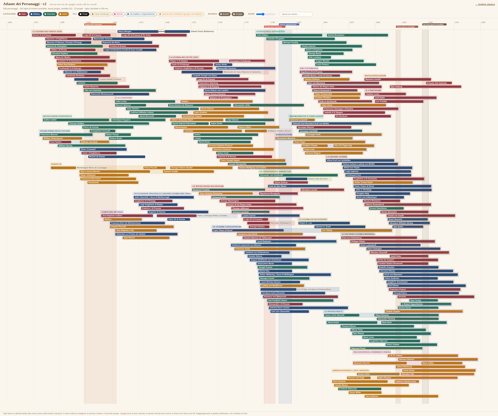

# Timeline dei personaggi storici

**Interactive history timeline & infographic poster** · 256 historical figures, 1553–1992 · kings, generals, scientists and artists: who lived at the same time as whom.

*🗺️ La versione 2 a pagina intera: 256 personaggi, 23 gruppi, zero scrolling. Generata con Claude: l'obiettivo è renderla ancora più bella.*

👉 **[Prova la timeline online](https://maloghigno.github.io/Timeline/classica/)** · 🧪 **[Versione 2 (gruppi, eventi, fili)](https://maloghigno.github.io/Timeline/v2/)** · 🚧 **[Versione 3, in lavorazione (parte vuota: i personaggi li inserisci tu)](https://maloghigno.github.io/Timeline/v3/)**

## 🐉 Demo: la timeline di Westeros

La versione 3 include una demo del mondo di George R. R. Martin: **[apri la timeline di Westeros](https://maloghigno.github.io/Timeline/v3/?demo=westeros)** (anche su [Cloudflare](https://timeline.maloghigno.workers.dev/v3/?demo=westeros)).

Copre circa 300 anni, dalla **Conquista di Aegon** (1 AC) alla **Guerra dei Cinque Re** (298–300 AC), con 56 personaggi, 21 draghi con i rispettivi cavalieri, 14 eventi e due fili: la **corona dei Sette Regni**, da Aegon I a Tommen, e **Dunk ed Egg**. Le casate hanno un colore ciascuna (Targaryen nero, Stark grigio, Baratheon oro, Lannister cremisi, Velaryon verde mare, draghi arancio fuoco).

**Per trovare i libri e le serie**
- 📚 *Le Cronache del ghiaccio e del fuoco* (*A Song of Ice and Fire*), cioè *Il Trono di Spade*, *Il Regno dei Lupi*, *Lo Scontro dei Re* e gli altri volumi. In TV: *Game of Thrones* / *Il Trono di Spade*.
- 📚 *Fuoco e sangue* (*Fire & Blood*), la storia dei Targaryen da Aegon I alla Danza dei Draghi. In TV: *House of the Dragon*.
- 📚 *Il Cavaliere dei Sette Regni* (*A Knight of the Seven Kingdoms*, i racconti di **Dunk ed Egg**: *Il cavaliere errante*, *Il cavaliere giurato*, *Il cavaliere misterioso*). In TV: *A Knight of the Seven Kingdoms*.
- 📚 *Il Mondo del ghiaccio e del fuoco* (*The World of Ice & Fire*), l'enciclopedia ufficiale del mondo.
- 🌐 Fonti delle date: [A Wiki of Ice and Fire](https://awoiaf.westeros.org) e [Timeline of major events](https://awoiaf.westeros.org/index.php/Timeline_of_major_events). Appunti e metodo in [`appunti/westeros.md`](appunti/westeros.md).

Parole chiave: *Westeros, Cronache del ghiaccio e del fuoco, A Song of Ice and Fire, George R. R. Martin, Il Trono di Spade, Game of Thrones, House of the Dragon, Fuoco e sangue, Il Cavaliere dei Sette Regni, Dunk ed Egg, Targaryen, Stark, Lannister, Baratheon, Velaryon, Hightower, Danza dei Draghi, Ribellione di Robert, Guerra dei Cinque Re, Aegon il Conquistatore*.

---

## 📜 Cos'è

Una **linea del tempo interattiva** con **256 personaggi storici** vissuti tra il 1553 e il 1992: da **Galileo** a **Churchill**, da **Napoleone** a **Picasso**, attraverso l'**Illuminismo**, il **Risorgimento**, le **Guerre mondiali**.

Risponde alla domanda che i libri di storia non hanno mai sopportato: *chi era vivo nello stesso momento di chi?* Spoiler: molti più di quanti pensi, e parecchi si conoscevano pure. Il che spiega diverse guerre.

Passa il mouse su un personaggio e compare la **schedina**: foto da Wikipedia, nome, date e una frase scritta a mano, cattiva il giusto.

> *Arciduca Carlo d'Austria (05/09/1771 – 30/04/1847): l'avversario di Napoleone che teorizzava la guerra mentre Clausewitz la rimuginava.*

## 🎲 Piccole coincidenze

- **Charlie Chaplin** (16/04/1889) e **Adolf Hitler** (20/04/1889) nascono a quattro giorni di distanza. Uno ha fatto ridere il mondo, l'altro no.
- **Charles Darwin** e **Abraham Lincoln** nascono lo stesso giorno, il 12/02/1809. Uno ha riscritto l'origine dell'uomo, l'altro i suoi diritti.
- **Mozart** e **Robespierre** sono quasi coetanei (1756 e 1758) e muoiono a tre anni di distanza: il primo a 35 anni, di malattia; il secondo a 36, di ghigliottina.

## 👥 Chi sono i 256 (per ora)

| Categoria | Chi | n |
|---|---|---|
| 👑 Main | re, regine, politici, dittatori | 68 |
| ⚔️ Military | generali, ammiragli, un paio di pirati | 64 |
| 🔭 Scientist | scienziati, filosofi, esploratori | 62 |
| 🎨 Artist | pittori, musicisti, scrittori, attori | 62 |

## 🚀 Come si usa

**Online:** [maloghigno.github.io/Timeline](https://maloghigno.github.io/Timeline/) (pagina di ingresso con le due versioni).

**In locale:** niente build, niente `npm install`, niente drammi. Scarica il repo e apri `index.html` (o direttamente `classica/index.html` e `v2/index.html`) nel browser. Serve la connessione, perché il grafico usa Google Charts e le foto arrivano da Wikipedia.

## 🛠️ Come è fatto

HTML e JavaScript puri, senza framework.

- **`index.html`**: la pagina di ingresso, che porta alle due versioni.
- **`classica/index.html`**: la timeline classica, con [LokiJS](https://github.com/techfort/LokiJS) come mini-database e [Google Charts Timeline](https://developers.google.com/chart/interactive/docs/gallery/timeline) per il disegno.
- **`src/personaggi.js`**: l'elenco dei 256 personaggi, condiviso da entrambe le versioni.
- **`src/descrizioni.js`**: le frasi delle schedine, una per personaggio.
- **`v2/index.html`**: la versione 2, in SVG puro: categorie mischiate, 23 gruppi come aree colorate dietro le barre, bande per gli eventi (es. le guerre mondiali), "fili" che uniscono personaggi lontani (pirati, Asburgo, donne, Galileo→Oppenheimer) e il gruppo secondario del Secolo d'oro olandese. Le righe sono calcolate prima di disegnare (`src/v2-layout.js`, deterministico) e i gruppi stanno in `src/gruppi.js`. Requisiti e scelte in [`V2_REQUISITI.md`](V2_REQUISITI.md).
- **`v3/index.html`** 🚧 *(in lavorazione)*: la v2 che parte vuota, per costruire la propria linea del tempo (per esempio quella di un libro fantasy, con anni inventati): personaggi, gruppi, categorie, fili ed eventi si inseriscono da un pannello e si salvano in JSON. Autonoma, con il proprio `layout.js`; formato dei dati in [`v3/README.md`](v3/README.md).
  - 🐉 **Demo: Westeros** ([apri online](https://maloghigno.github.io/Timeline/v3/?demo=westeros)): la cronologia delle *Cronache del ghiaccio e del fuoco* di George R. R. Martin, dalla Conquista di Aegon alla Guerra dei Cinque Re. Ci sono 56 personaggi e 21 draghi, compresi i protagonisti di *House of the Dragon* e del *Cavaliere dei Sette Regni* (Dunk ed Egg). Le casate fanno da colori: Targaryen in nero, Stark in grigio, Baratheon in oro, Lannister in cremisi, Velaryon in verde mare, draghi in arancio fuoco. Ci sono poi 14 eventi, il filo d'oro della corona dei Sette Regni (da Aegon I a Tommen) e quello che unisce Dunk ed Egg. Le date sono verificate su [A Wiki of Ice and Fire](https://awoiaf.westeros.org); appunti e fonti sono in [`appunti/westeros.md`](appunti/westeros.md).
- **`asset/`**: il poster.

## ➕ Aggiungere un personaggio

1. Una riga nell'elenco di `src/personaggi.js`. ⚠️ **In JavaScript i mesi partono da 0**: gennaio è `0`, dicembre è `11`. È già successo, non succederà più (forse).
2. Per la v2, il nome va anche in `ASSEGNAZIONI` di `src/gruppi.js` (massimo 2 gruppi).
3. Se la data esatta non si conosce, `birth_year_only: true` e/o `death_year_only: true`.
4. Una frase in `src/descrizioni.js`, con lo stesso identico nome.

Se una foto non compare, di solito il titolo della voce Wikipedia non coincide con il nome: basta aggiungerlo a `WIKI_TITOLI` in `classica/index.html`. Altrimenti restano le iniziali, che fanno comunque la loro figura.

## 💬 Contribuire

Manca il tuo personaggio preferito? Hai trovato una data sbagliata? Hai un'idea per rendere tutto più bello o interattivo? **[Apri una issue](https://github.com/Maloghigno/Timeline/issues)**.

Le **frasi sono opinioni**, non fonti. Le date sono state controllate dove c'era un dubbio, ma qualche errore può sempre sfuggire: è storia, non teologia.

## 🙏 Crediti

- Foto dei personaggi: [Wikipedia](https://it.wikipedia.org), caricate dal browser al momento.
- Grafico: [Google Charts](https://developers.google.com/chart). Mini-database: [LokiJS](https://github.com/techfort/LokiJS).
- Frasi, raggruppamenti del poster e scelta dei personaggi: opinioni dell'autore, da prendere come tali.

## 📄 Licenza

[MIT](LICENSE) © 2026 Federico ([Maloghigno](https://github.com/Maloghigno)). Puoi riusare, modificare e ridistribuire liberamente, a patto di conservare la nota di copyright con l'attribuzione all'autore.

---

🔎 *Parole chiave: storia, linea del tempo, timeline storica, infografica, personaggi storici, storia moderna, storia contemporanea, Barocco, Illuminismo, Rivoluzione francese, Napoleone, Risorgimento, Prima guerra mondiale, Seconda guerra mondiale, storia della scienza, storia dell'arte · history timeline, historical figures, infographic, data visualization, world history.*
