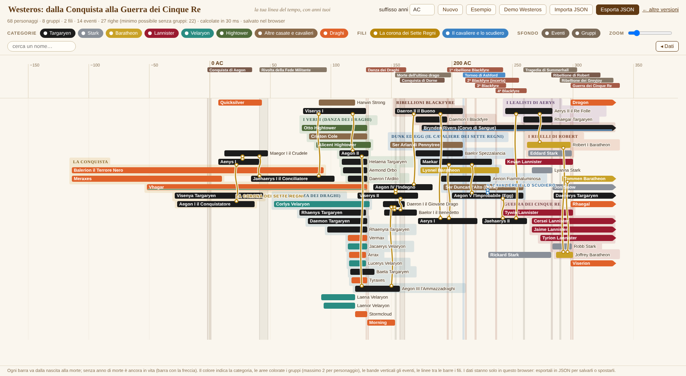

# Timeline v3 (in lavorazione)

La v2 che parte vuota: inserisci tu personaggi, gruppi, categorie, fili ed eventi, con anni tuoi (interi, anche negativi), per esempio per la cronologia di un libro fantasy.

- **Anni interi.** Barra dalla nascita alla morte; morte vuota = ancora in vita (barra con la freccia). Suffisso degli anni a piacere (es. «E.S.»).
- **Gruppi** assegnati a mano, massimo 2 per personaggio. **Fili** per i legami (dinastie, maestro e allievo…). **Eventi** come bande verticali.
- **Righe calcolate prima di disegnare**, con lo stesso motore della v2 (`layout.js`, deterministico).
- **Dati solo nel browser** (localStorage): per salvarli o spostarli usa **Esporta JSON** e **Importa JSON**.
- Il pulsante **Esempio** carica un piccolo regno inventato.

## Demo: Westeros 🐉

Il pulsante **Demo Westeros** (o il link [`v3/?demo=westeros`](https://maloghigno.github.io/Timeline/v3/?demo=westeros)) carica la cronologia delle *Cronache del ghiaccio e del fuoco* di George R. R. Martin.

- Copre il periodo dalla Conquista di Aegon (anni AC; quelli prima sono negativi) alla Guerra dei Cinque Re.
- Ci sono 56 personaggi e 12 draghi, compresi quelli di *House of the Dragon* e del *Cavaliere dei Sette Regni*.
- La casata è il colore della barra: Targaryen in nero, Stark in grigio, Baratheon in oro, Lannister in cremisi, Velaryon in verde mare, Hightower in verde oliva, draghi in arancio fuoco.
- Ci sono 8 gruppi (i Neri e i Verdi della Danza dei Draghi, Dunk ed Egg, le ribellioni Blackfyre, i ribelli di Robert…) e 14 eventi.
- Il filo **La corona dei Sette Regni** segue i 20 re nell'ordine di successione (`"ordine": "elenco"`), non di nascita. Il filo **Il cavaliere e lo scudiero** unisce Dunk ed Egg.
- Le date vengono da [A Wiki of Ice and Fire](https://awoiaf.westeros.org). Dove la fonte dà un intervallo, la barra parte dal primo anno e la scheda lo dice. Dati, tranelli e draghi esclusi sono in [`../appunti/westeros.md`](../appunti/westeros.md).
- File: [`demo/westeros.json`](demo/westeros.json) e l'anteprima [`demo/westeros.png`](demo/westeros.png).
- Il pulsante legge il file via web: aprendo la pagina direttamente dal computer (`file://`) il browser lo blocca, e in quel caso si usa **Importa JSON**.



## Formato del file JSON

```json
{
  "versione": 3,
  "titolo": "Il mio libro",
  "suffisso": "E.S.",
  "categorie": [{ "id": "c1", "nome": "Sovrani", "colore": "#8e3b46" }],
  "gruppi":    [{ "id": "g1", "nome": "Casa dei Corvi", "colore": "#b4565c" }],
  "personaggi": [{ "id": "p1", "nome": "Aldric", "nascita": 1090, "morte": 1161,
                   "categoria": "c1", "gruppi": ["g1"], "descrizione": "…" }],
  "fili":      [{ "id": "f1", "nome": "La stirpe", "colore": "#b4565c", "membri": ["p1"], "ordine": "nascita" }],
  "eventi":    [{ "id": "e1", "nome": "La Guerra", "da": 1187, "a": 1194, "colore": "#6b4a3a" }]
}
```

`morte: null` = ancora in vita. Per i fili, `ordine` vale `"nascita"` (i membri collegati per anno di nascita, predefinito) oppure `"elenco"` (nell'ordine di `membri`, per esempio una successione al trono). Gli id sono stringhe a scelta, uniche; i colori sono esadecimali `#rrggbb`.
In importazione i dati vengono controllati: un file non valido viene rifiutato con il motivo.
